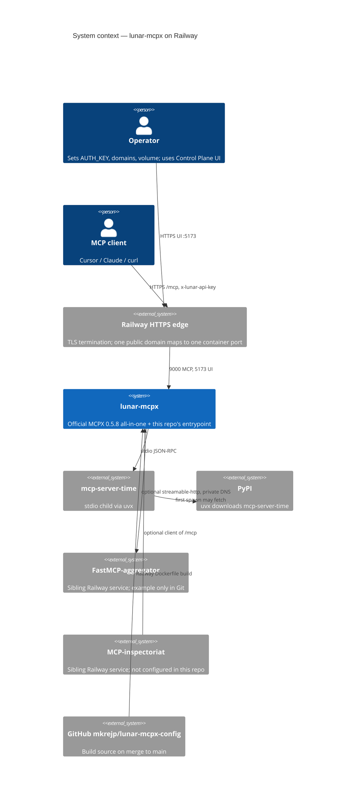
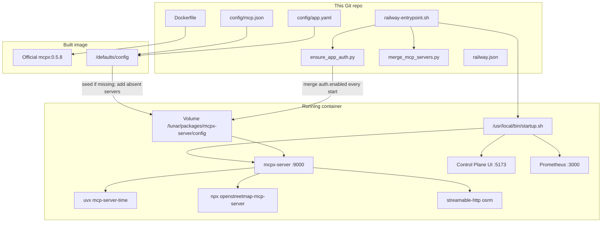
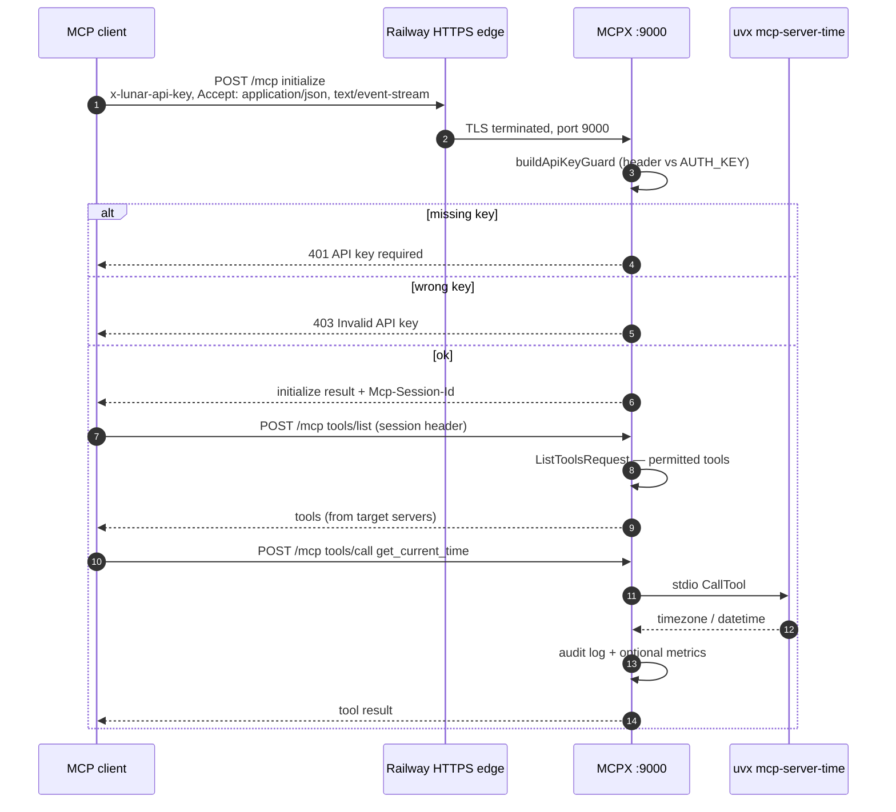

# Architecture

This document describes the **solution defined by this repository**: a Railway
deployment of [Lunar MCPX](https://github.com/TheLunarCompany/lunar/tree/main/mcpx)
0.5.8 (MCP gateway / aggregator), plus the thin wrapper that seeds config and
fail-closes on a missing API key.

This repo does **not** contain the MCPX application source. The running process
is the official all-in-one image. Statements about MCPX internals are taken from
upstream tag **0.5.8** (`mcpx/packages/mcpx-server`) unless marked as an
assumption.

Live Railway facts below were read from the `perfect-eagerness` production
environment on 2026-11-01. Dashboard settings can drift from Git; mismatches are
called out.

Related: [CONNECTIVITY.md](CONNECTIVITY.md) (trust boundaries, ports, inventory).

## Purpose and scope

**Purpose.** Give MCP clients (Cursor, Claude, curl, and similar) a single
authenticated Streamable HTTP endpoint that aggregates tools from one or more
upstream MCP servers, with a Control Plane UI for inspecting and editing that
set.

**In this repo.**

| Path | Role |
| --- | --- |
| `Dockerfile` | Thin wrapper around `us-central1-docker.pkg.dev/prj-common-442813/mcpx/mcpx:0.5.8` |
| `MCPX_VERSION` | Pinned tag (`0.5.8`) |
| `config/mcp.json` | Seeded MCP server list. Missing names are added on every start; existing entries are not replaced |
| `config/app.yaml` | Seeded ACL / auth / tool groups; `auth.enabled` is merged on every start |
| `config/mcp.remote.example.json` | Example adding a private-network HTTP MCP server; **not** copied into the image |
| `docker/railway-entrypoint.sh` | Volume seed, missing-server merge, auth merge, `AUTH_KEY` check, then `exec /usr/local/bin/startup.sh` |
| `docker/ensure_app_auth.py` | YAML merge + fail-closed `AUTH_KEY` check |
| `docker/merge_mcp_servers.py` | Insert default MCP servers whose names are absent on the volume |
| `railway.json` | Builder Dockerfile, healthcheck `/healthcheck`, restart on failure |
| `.railway/railway.ts` | Optional IaC description of the existing service; **not** applied as the owner of the service |
| `.env.example` | Variable catalog for the Railway dashboard |
| `tests/` | Pytest for the entrypoint helpers only |

**Out of scope for this repo.** MCPX server/UI source, Hub/enterprise mode,
Lunar AI Gateway interception, Docker-in-Docker stdio servers, and the sibling
Railway services `FastMCP-aggregator` and `MCP-inspectoriat` (they share the
project; they are not built from this Git repo).

## System context

## Component / module overview

**Runtime processes (one Railway replica).**

1. **Upstream entrypoint** (kept from the official image) — privileged / DinD
   probe. This repo sets `DIND_ENABLED=false`; Railway containers are not
   privileged.
2. **`railway-entrypoint.sh` (CMD)** — creates `audit-logs/`, seeds
   `mcp.json` / `app.yaml` only when absent on the volume, inserts default MCP
   servers that are missing from an existing `mcp.json` (does not replace or
   delete entries), writes a minimal auth-enabled `app.yaml` if both volume and
   image default are missing, merges `auth.enabled: true` into the existing
   volume file, refuses to start when `AUTH_KEY` is empty, `chown`s the volume
   to user `lunar` (uid 1002), exports `APP_CONFIG_PATH` /
   `SERVERS_CONFIG_PATH` / `AUDIT_LOG_DIR`, then
   `exec /usr/local/bin/startup.sh`.
3. **MCPX server** — Express HTTP on `MCPX_PORT` (9000). Logs from the live
   deploy: `MCPX server started on port 9000`, `API key guard is enabled`,
   `version="0.5.8"`.
4. **Control Plane UI** — Vite/static UI on `UI_PORT` (5173). Same logs:
   `uiStatus="Connected"`.
5. **Metrics** — optional Prometheus listener on `SERVE_METRICS_PORT` (default
   3000). `ENABLE_METRICS=true` is set on the service; this repo does not
   attach a public domain to 3000.
6. **Stdio children** — spawned by MCPX when `ENABLE_STDIO_MCP_SERVERS=true`
   (set on the service and in `.env.example`). Commands from `config/mcp.json`:
   `time` via `uvx --with mcp<2.0.0 mcp-server-time --local-timezone=Europe/Prague`,
   and `openstreetmap-mcp-server` via
   `npx -y @cyanheads/openstreetmap-mcp-server` with
   `OSM_USER_AGENT=animarium-lunar-mcpx/1.0`. The first OpenStreetMap spawn
   downloads the package from npm.
7. **Remote child `osrm`** — Streamable HTTP to
   `https://gateway.pipeworx.io/osrm/mcp` (Pipeworx pack scoped to OSRM, no
   API key). `https://pipeworx.io` itself is the marketing site and rejects
   MCP `initialize`.

**Git-tracked modules that are not in the running container.** `.railway/`
is listed in `.dockerignore`. Markdown files are also dockerignored. Tests
run only in CI / local pytest, not in the image.

## Exposed / configured MCP servers, tools, resources, prompts

### Gateway surface (MCPX 0.5.8, this deploy)

The container presents **one** MCP server named `mcpx` (upstream
`mcp-gateway.ts`) to downstream clients. It lists and invokes capabilities
collected from configured target servers, filtered by `config/app.yaml`
permissions.

| Kind | This deploy | Source |
| --- | --- | --- |
| **Tools** | Aggregated from target servers. Seeded targets are `time`, `openstreetmap-mcp-server`, `osrm`, `pipeworx`, and `switzerland-mcp` (retired names are listed in `config/mcp.prune.json`). | `config/mcp.json`; MCPX `ListToolsRequest` / `CallToolRequest` |
| **Prompts** | **Not advertised.** `ENABLE_PROMPT_CAPABILITY` is unset; upstream default is `false`, so prompt handlers are not registered. | MCPX `env.ts` + `mcp-gateway.ts` |
| **Resources** | **Not advertised.** `ENABLE_RESOURCE_CAPABILITY` is unset; upstream default is `false`. | same |
| **Skills** | Skill REST router is mounted at `/skills`. `ENABLE_SKILL_SCOPING` is unset (default `false`). `toolGroups: []` in seeded `app.yaml`. | `app.yaml`; MCPX `build-server.ts` / `env.ts` |

MCP JSON-RPC is served on:

| Path | Transport | Auth |
| --- | --- | --- |
| `POST/GET/DELETE /mcp` | Streamable HTTP | `x-lunar-api-key` when `auth.enabled` |
| `GET/POST /sse` | Legacy SSE | same |
| `POST /messages` | Legacy SSE message post (`?sessionId=`) | same |

`/healthcheck` is **not** behind the API-key guard (MCPX `build-server.ts`).

### Target MCP servers configured in Git

**Seeded (`config/mcp.json`) — copied when `mcp.json` is absent; on later starts, names that are missing are inserted and existing entries are left as-is:**

| Name | Type | Command or URL | Notes |
| --- | --- | --- | --- |
| `time` | `stdio` | `uvx --with mcp<2.0.0 mcp-server-time --local-timezone=Europe/Prague` | Harmless sample; needs no Docker. Image includes `uv` and Node. |
| `openstreetmap-mcp-server` | `stdio` | `npx -y @cyanheads/openstreetmap-mcp-server` | Env `OSM_USER_AGENT=animarium-lunar-mcpx/1.0`. First spawn downloads from npm. `npx` is an MCPX allowed command. |
| `osrm` | `streamable-http` | `https://gateway.pipeworx.io/osrm/mcp` | Public OSRM pack (route, table, nearest, match, trip). No auth header. MCPX requires `type: streamable-http` on remote targets. |
| `geocode-mcp` | `stdio` | `npx -y geocode-mcp` | Env `GEOCODE_USER_AGENT=MyGeographicApp/1.0 (contact@example.com)`. Nominatim geocoding, no API key. |
| `mcp-nominatim` | `stdio` | `npx -y @pipeworx/mcp-nominatim` | Published scope is `@pipeworx`, not `@pipeworx-io`. |
| `switzerland-mcp` | `stdio` | `npx -y mcp-swiss` | Vikram Gorla's package is `mcp-swiss`. `@vikramgorla/swiss-mcp` is not on npm. |

**Example only (`config/mcp.remote.example.json`) — not seeded:**

| Name | Type | URL |
| --- | --- | --- |
| `fastmcp-aggregator` | `streamable-http` | `http://fastmcp-aggregator.railway.internal:8080/mcp` |

The live volume may already contain extra servers added via the Control Plane
UI. Those entries are kept. A Git-tracked server that is deleted in the UI is
added again on the next start. An edited command or env for a name that still
exists is not replaced from Git.

### Tools from the seeded `time` server

This repo does not define tool schemas. The package `mcp-server-time` (MCP
official servers) documents:

| Tool | Purpose |
| --- | --- |
| `get_current_time` | Current time in an IANA timezone |
| `convert_time` | Convert `HH:MM` between IANA timezones |

**Assumption:** MCPX prefixes or otherwise namespaces tool names when multiple
target servers are present. With a single `time` server, clients typically see
these two names (or a `time__…` prefixed form). Confirm with an authenticated
`tools/list` against the live `/mcp`.

**Assumption / pin risk:** Git config uses `--with mcp<2.0.0`. Current
`mcp-server-time` README requires `mcp>=2.3,<3`. First `uvx` spawn may fail or
resolve an older time-server release. Check container logs if `time` does not
appear in the UI.

`mcp-server-time` registers **no prompts and no resources**.

### HTTP APIs besides MCP (MCPX 0.5.8)

Mounted in `build-server.ts`. Control-plane REST is on because
`ENABLE_CONTROL_PLANE_REST=true` (dashboard + `.env.example`).

| Prefix | Guard | Role |
| --- | --- | --- |
| `GET /healthcheck` | none | `{ "status": "OK" }` |
| `/mcp`, `/sse`, `/messages` | API key | MCP transports |
| OAuth router | **none** (comment: public) | Upstream-server OAuth |
| Auth-MCPX router | **none** | Hub/instance auth helpers |
| `/admin` | API key | Admin |
| `/identity` | API key | Identity |
| Control plane (`/system-state`, `/audit-logs`, `/app-config`, `/target-server`, …) | API key | UI backend |
| `/config` | API key | App config |
| `/catalog` | API key | Server catalog |
| `/skills` | API key | Skills |
| UI WebSocket | bound on the same HTTP server as MCP | Control Plane streaming (`ENABLE_CONTROL_PLANE_STREAMING=true`) |

CORS `allowedHeaders` in 0.5.8 includes `Content-Type`, `Authorization`,
`X-API-Key`, `Mcp-Session-Id`, `MCP-Protocol-Version`, `Last-Event-ID` — **not**
`x-lunar-api-key`. Browser calls from a different origin can fail preflight;
Cursor / Claude / curl are unaffected.

## Runtime and request flow

**Container start**

1. Railway starts the image as uid 0 (`RAILWAY_RUN_UID=0`) so the volume
   (mounted as root) can be reowned.
2. Official entrypoint runs, then `CMD` = `railway-entrypoint.sh`.
3. Seed / merge / `check-auth-key` as above. Empty `AUTH_KEY` → exit 1
   (this repo). Upstream MCPX would otherwise enable auth in `app.yaml` and
   then **fail-open** (`noOpAuthGuard`) if `AUTH_KEY` is missing.
4. `startup.sh` starts server + UI. Hub connect is attempted and **fails**
   with `setupOwnerId is not provided` in live logs; `ENFORCE_HUB_CONNECTION`
   is not set (upstream default `false`), so the process continues.

**Typical MCP tool call (Streamable HTTP)**

Permissions in the seeded `app.yaml` are allow-all (`permissions.base: allow`,
`permissions.default.block: []`, `consumers: {}`), so the guard is the API key,
not ACL.

## Configuration and environment variables

**Files on the volume** (`/lunar/packages/mcpx-server/config`):

| File | Seed policy |
| --- | --- |
| `mcp.json` | Copy from image `/defaults/config` **only if missing**. Every start, add default server names that are absent. Do not replace existing entries and do not delete volume-only servers. |
| `app.yaml` | Copy if missing; **every start** merge `auth.enabled: true` and default `header: x-lunar-api-key` if `header` is absent. Other keys (`permissions`, `toolGroups`, `toolExtensions`) are not rewritten. |
| `audit-logs/` | Created every start. `ENABLE_AUDIT_LOG` defaults true in MCPX. |

Entrypoint override env: `MCPX_CONFIG_DIR`, `MCPX_DEFAULTS_DIR`,
`ENSURE_APP_AUTH`, `MCPX_SKIP_START=1` (used by tests; skips `startup.sh`).

**Required for this Railway service** (from `.env.example` and
`.railway/railway.ts`; names confirmed present on the live service unless noted):

| Variable | Intended value | Live service 2026-11-01 |
| --- | --- | --- |
| `PORT` | `9000` (Railway healthcheck target) | set |
| `MCPX_PORT` | `9000` | set |
| `MCPX_SERVER_URL` | `http://127.0.0.1:9000` | set |
| `UI_PORT` / `UI_URL` | `5173` / `http://127.0.0.1:5173` | set |
| `AUTH_KEY` | dashboard secret; never in Git | set (value not readable via OAuth) |
| `ENABLE_STDIO_MCP_SERVERS` | `true` | set |
| `DIND_ENABLED` | `false` | set |
| `LUNAR_TELEMETRY` | `false` | set |
| `ENABLE_METRICS` | `true` | set |
| `ENABLE_CONTROL_PLANE_REST` / `_STREAMING` | `true` | set |
| `RAILWAY_RUN_UID` | `0` | set |
| `VITE_MCPX_SERVER_URL` | `https://${{RAILWAY_PUBLIC_DOMAIN}}` | set |
| `VITE_MCPX_SERVER_PORT` | `443` | set |
| `VITE_WS_URL` | `wss://${{RAILWAY_PUBLIC_DOMAIN}}` | set |
| `OAUTH_CALLBACK_BASE_URL` | public MCP origin | set |
| `CORS_ORIGINS` | MCP public origin; **must also include the UI origin** | set (value not shown) |
| `LOG_LEVEL` | `info` | set |

Documented in Git but **not** among the 19 operator-defined live variables:
`MCPX_SERVER_PORT`, `APP_CONFIG_PATH`, `SERVERS_CONFIG_PATH`, `AUDIT_LOG_DIR`,
`SERVE_METRICS_PORT`. The entrypoint exports the three paths if unset. MCPX
defaults `SERVE_METRICS_PORT` to 3000.

Full optional catalog (Hub, JWT injection, Loki, tool-call cache, ping
intervals, Auth0 UI flags, …) is in [`.env.example`](../.env.example). Secrets
named there that this deploy does **not** set: `LUNAR_API_KEY`, Loki
credentials, Auth0, `INSTANCE_KEY`.

Railway injects `RAILWAY_*` (project, service, volume, public/private domain,
and `RAILWAY_SERVICE_FASTMCP_AGGREGATOR_URL` / `RAILWAY_SERVICE_MCP_INSPECTORIAT_URL`
cross-service references). Those names exist on the live service; values were
not read.

## Build and deployment

**Intended path (this repo).**

1. Merge to `main`. Railway source is `mkrejp/lunar-mcpx-config` @ `main`.
2. `railway.json` asks for Dockerfile builder, `Dockerfile` at repo root,
   healthcheck `GET /healthcheck` timeout 300 s, restart `ON_FAILURE` / 10
   retries.
3. Dockerfile: `FROM …/mcpx:${MCPX_VERSION}`, copy defaults + entrypoint,
   `chmod`, `CMD railway-entrypoint.sh`. Upstream `ENTRYPOINT` is kept.
4. One replica in `europe-west4-drams3a`. Volume mounted at
   `/lunar/packages/mcpx-server/config`. Overlap/zero-downtime is not used
   with a volume (README); live `MCP-inspectoriat` explicitly sets
   `overlapSeconds: 0` — **assumption:** `lunar-mcpx` behaves the same because
   of the volume.

**Live build 2026-11-01** (deployment `0f0bab61…`, commit `5e6820f`): build
logs show a Docker build from this `Dockerfile` pulling
`mcpx:0.5.8@sha256:820508fb57ac88516375f59e6f3f2c067bce9ce01fec2a94d19b72d84da01382`.
The Railway API nevertheless reports `builder: RAILPACK` for the service.
**Assumption:** Dockerfile detection still wins when a `Dockerfile` is present;
treat `railway.json` + build logs as the source of truth over the builder
enum until dashboard Config-as-Code cutoff (README: 2026-12-01).

**Live deploy vs Git.**

| Item | This repo | Live production |
| --- | --- | --- |
| Healthcheck path | `/healthcheck` in `railway.json` | Deploy config returned **no** `healthcheckPath`. Runtime logs show Railway `HEAD /` → 200 from `100.64.0.1`. |
| Volume name / size | IaC: `lunar-mcpx-data` 1 GB | `lunar-mcpx-volume` **50 GB** |
| Private DNS | README: `lunar-mcpx.railway.internal` | API `privateNetworkEndpoint`: `lunar-mcpx-config` |
| Public domains | MCP 9000 + UI 5173 | those two **plus** `lunar-mcpx-production-d6f2.up.railway.app` → **8080** (no listener in this image) |

Update the MCPX version by changing `ARG MCPX_VERSION` in `Dockerfile` and
the `MCPX_VERSION` file, then merge.

**Local tests (this repo only):** `pyproject.toml` — Python ≥ 3.11, pytest
dev extra, ruff src `docker` + `tests`. No GitHub Actions workflow is in the
tree.

## Security

**Authentication**

- Shared secret env `AUTH_KEY` compared to header `x-lunar-api-key`
  (`auth.header` in `app.yaml`; default matches).
- `auth.enabled: true` is Git-seeded and re-merged every start so a volume
  from before auth was enabled cannot stay fail-open.
- This image **will not start** without a non-whitespace `AUTH_KEY`.
- `/healthcheck`, OAuth router, and Auth-MCPX router skip the API-key guard
  (upstream). Railway edge health used `HEAD /` in live logs (also unauthenticated).
- `ALLOWED_IP_RANGES` is documented but **unset** (all IPs).
- JWT (`MCPX_AUTH_JWKS_URI` / issuer / audience) is optional and unset —
  used to inject into hosted child MCP processes, not as the gateway API-key
  replacement.
- Hub/enterprise (`INSTANCE_KEY`) unset; standalone mode.
- UI Auth0 / login flags in `.env.example` are commented out.

**Secrets handling**

- `.gitignore` ignores `.env` and `.env.*` except `.env.example`.
- `.env.example` leaves `AUTH_KEY=` and `LUNAR_API_KEY=` empty.
- `.railway/railway.ts` comments that `AUTH_KEY` must not be committed.
- `LOG_REDACT_KEYS` defaults to `env` in MCPX (not overridden here).
- `ensure_app_auth.py` never prints the secret value.

**Other**

- `LUNAR_TELEMETRY=false` — do not ship logs to Lunar Loki from this instance.
- Stdio servers: `STDIO_INHERIT_PROCESS_ENV` default `false` (unset here), so
  child `uvx` does not inherit the full process env (including `AUTH_KEY`)
  unless changed.
- `RAILWAY_RUN_UID=0` is required for volume `chown`; the MCPX process then
  drops to `lunar`.
- ACL is allow-all until someone edits `app.yaml` / UI consumers.

## Observability

| Signal | Where | Exposure |
| --- | --- | --- |
| Process logs | stdout, `LOG_LEVEL=info` | Railway deploy logs |
| Access logs | MCPX; `/healthcheck` ignored; `/mcp` GET/POST/DELETE hidden unless `LOG_CLIENT_ACCESS_LOG` | Railway |
| Audit | `AUDIT_LOG_DIR` on the volume; REST `GET /audit-logs` (API key) | volume + Control Plane |
| Prometheus | `:3000/metrics` when `ENABLE_METRICS=true` | **private only** (no public domain in this setup) |
| Tracing | Railway service tracing **off**, auto-instrumentation **off** (live API) | — |
| Hub usage stats | Hub connect fails; not enforced | unused |
| Control Plane UI | live traffic / servers | public domain on 5173 |

Live logs also show repeated `API key not provided in headers` (unauthenticated
probes) and `ListToolsRequest received` on `/mcp` (authenticated clients).

## Limitations and future improvements

1. **Config as Code vs dashboard.** `railway.json` is deprecated for new
   services (cutoff 2026-12-01 per README). Dashboard currently omits the
   Git healthcheck path and reports builder RAILPACK. Align dashboard with
   Dockerfile + `/healthcheck` on port 9000, or adopt `.railway/railway.ts`
   as the single owner (do not run both).
2. **Extra public domain on 8080.** Live
   `lunar-mcpx-production-d6f2.up.railway.app` targets 8080. This image
   listens on 9000 / 5173 / 3000. Remove or retarget that domain.
3. **CORS vs UI domain.** UI is a second origin (port 5173). `CORS_ORIGINS`
   must include that origin or the browser Control Plane cannot call `:9000`.
   Confirm the live value includes `https://lunar-mcpx-production-ui.up.railway.app`.
4. **CORS vs API key header.** Add `x-lunar-api-key` to MCPX
   `allowedHeaders` (upstream change) if browser clients need it.
5. **Volume `mcp.json` edits.** Missing Git servers are inserted on start.
   Edits to an existing server, and servers that exist only on the volume, are
   not synced back to Git and are not overwritten. Removing a Git-tracked
   server in the UI does not stick across restart.
6. **`fastmcp-aggregator` is example-only.** Sibling service exists and is
   often sleeping; it is not in seeded `mcp.json`. Add it via UI or replace
   volume `mcp.json` if that hop is desired.
7. **Hub error on every boot.** Harmless while `ENFORCE_HUB_CONNECTION` is
   false; noisy. Keep Hub vars unset for standalone, or supply Hub credentials
   if enterprise is intended.
8. **Stdio `uvx` on Railway.** First spawn hits PyPI; `mcp<2.0.0` pin may
   fight current `mcp-server-time`. Prefer remote `streamable-http` servers
   for anything heavier. `command: docker` will not work (`DIND_ENABLED=false`).
9. **Prompts / resources off.** Set `ENABLE_PROMPT_CAPABILITY` /
   `ENABLE_RESOURCE_CAPABILITY` if aggregated prompts/resources are required.
10. **No CI in this repo.** Only local pytest for the Python helper.
11. **IPv6.** `ipv6EgressEnabled: false` on the live service. README notes
    possible `*.railway.internal` issues on newer environments; this one has
    IPv6 egress off.
12. **`app.yaml` schema dualism.** File contains both Helm
    `permissions.base: allow` and newer `permissions.default.block: []`.
    Live 0.5.8 accepted the file (server started with API key guard enabled).
)
