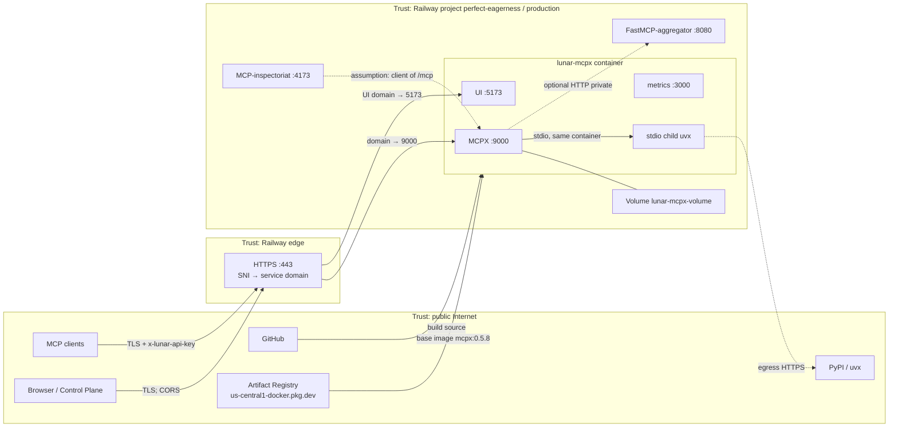
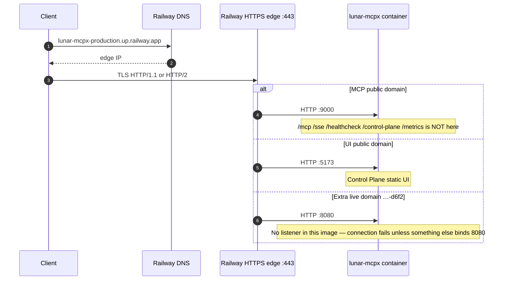
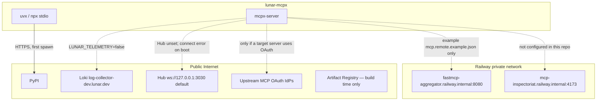

# Connectivity

Inbound and outbound connections for **lunar-mcpx**, the Railway service built
from this repository. Companion to [ARCHITECTURE.md](ARCHITECTURE.md).

Facts about **this Git repo** come from `Dockerfile`, `railway.json`,
`.railway/railway.ts`, `.env.example`, and `config/*`. Facts about **live
production** were read from Railway project `perfect-eagerness` /
environment `production` / service `lunar-mcpx` on 2026-11-01. Anything not
verified in those sources is marked **assumption**.

## Trust boundaries

**Boundaries.**

| Boundary | What crosses it | Control |
| --- | --- | --- |
| Internet → Railway edge | HTTPS to public service domains | Railway TLS; no TCP proxy on this service |
| Edge → container port | HTTP to **one** target port per domain | Domain → port mapping |
| Unauthenticated vs MCP | `/healthcheck` (and live `HEAD /`) open; `/mcp` requires `AUTH_KEY` | MCPX `buildApiKeyGuard` + this image's start-time check |
| Container → volume | `mcp.json`, `app.yaml`, audit logs | Mount path only; no network |
| Container → sibling services | HTTP on `*.railway.internal` | Private DNS, no public hop required |
| Container → world | Image pull (build time); `uvx` → PyPI (runtime); telemetry **disabled** | `LUNAR_TELEMETRY=false`; `DIND_ENABLED=false` |

Private network endpoint reported by Railway for this service:
**`lunar-mcpx-config`** (so `lunar-mcpx-config.railway.internal`). README also
documents `lunar-mcpx.railway.internal`. Use Settings → Networking if unsure.

## Inbound path

**Public domains (live, 2026-11-01).**

| Hostname | Target port | Intended use |
| --- | --- | --- |
| `https://lunar-mcpx-production.up.railway.app` | **9000** | MCP + healthcheck + Control Plane REST |
| `https://lunar-mcpx-production-ui.up.railway.app` | **5173** | Control Plane UI |
| `https://lunar-mcpx-production-d6f2.up.railway.app` | **8080** | **Not defined by this repo.** Official image listens on 9000, 5173, 3000. |

Clients on the internet:

- MCP: `https://lunar-mcpx-production.up.railway.app/mcp` with header
  `x-lunar-api-key: <AUTH_KEY>`.
- Legacy SSE: same host `/sse`.
- Health: `https://lunar-mcpx-production.up.railway.app/healthcheck` (no key).
- UI: `https://lunar-mcpx-production-ui.up.railway.app/`. The browser then
  calls the MCP origin using `VITE_MCPX_SERVER_URL` / `VITE_WS_URL`
  (`wss://` on the MCP domain, port **443** via `VITE_MCPX_SERVER_PORT`).

Same-environment services should use
`http://lunar-mcpx-config.railway.internal:9000` (live endpoint name) rather
than the public URL.

**Auth points on the inbound path.**

1. **TLS** at the Railway edge (public hostnames only).
2. **API key** at MCPX on `/mcp`, `/sse`, `/messages`, `/admin`, `/identity`,
   control-plane REST, `/config`, `/catalog`, `/skills` — header
   `x-lunar-api-key` vs env `AUTH_KEY`.
3. **Not authenticated:** `GET /healthcheck`; OAuth callback/discovery router;
   Auth-MCPX router; live Railway probe `HEAD /` (returns 200 in deploy logs).
4. **CORS** at MCPX for browser origins listed in `CORS_ORIGINS`.
5. **Optional IP allow-list** `ALLOWED_IP_RANGES` — unset ⇒ all IPs.
6. **No TCP proxy** on this service.

## Outbound connections

| Destination | When it happens | Auth |
| --- | --- | --- |
| PyPI (via `uvx`) | Spawn of seeded `time` server | none (public index) |
| npm (via `npx`) | First spawn of seeded `openstreetmap-mcp-server` (`@cyanheads/openstreetmap-mcp-server`) | none (public registry) |
| `https://gateway.pipeworx.io/osrm/mcp` | Seeded `osrm` target, Streamable HTTP `initialize` / tool calls | none (public demo) |
| `http://fastmcp-aggregator.railway.internal:8080/mcp` | Only if that server is added on the volume / UI. Git example file is **not** seeded. Live aggregator service exists, often **SLEEPING**, public domain on 8080. | **assumption:** whatever that service implements; example JSON has no headers |
| MCP-inspectoriat | Not a target in this repo. Inspectoriat has `REMOTE_MCP_URL` among its variables — **assumption:** it is an MCP **client** of lunar-mcpx, not an upstream. | inspectoriat's own Google OAuth / secrets; MCPX API key if it calls `/mcp` |
| Lunar Loki | Disabled (`LUNAR_TELEMETRY=false`) | n/a |
| MCPX Hub | Default URL `ws://127.0.0.1:3030`; live log `Cannot connect to Hub: setupOwnerId is not provided`. `ENFORCE_HUB_CONNECTION` default false. | Hub `INSTANCE_KEY` unset |
| Upstream OAuth IdPs | If a target MCP server's auth flow is started from Control Plane | OAuth; callback base `OAUTH_CALLBACK_BASE_URL` |
| Artifact Registry | Railway **build**, not runtime | Railway's pull of the public MCPX image |

IPv6 egress is **disabled** on the live service (`ipv6EgressEnabled: false`).

## Transports, ports, listeners

| Port | Process | Transport | Public? | Notes |
| --- | --- | --- | --- | --- |
| **9000** | MCPX server | HTTP (Streamable HTTP JSON-RPC on `/mcp`; SSE on `/sse`; REST; WS for UI) | Yes — primary domain | `PORT` / `MCPX_PORT` must match so Railway health and the domain target the same socket |
| **5173** | Control Plane UI | HTTP | Yes — second domain | One Railway domain = one port |
| **3000** | Prometheus | HTTP `GET /metrics` | **No** | Reachable on private DNS if needed |
| **8080** | *(none in this image)* | — | Accidental public domain in live config | FastMCP-aggregator (other service) is the process that actually listens on 8080 |
| stdio | `uvx mcp-server-time`, `npx @cyanheads/openstreetmap-mcp-server` | MCP over stdin/stdout pipes | No | Same network namespace; no TCP |

Loopback used inside the container: UI → `MCPX_SERVER_URL=http://127.0.0.1:9000`.

## Connection inventory

Direction is from the **source**'s perspective.

| Source | Destination | Protocol | Port | Auth | Direction | Evidence |
| --- | --- | --- | --- | --- | --- | --- |
| MCP client (Cursor/Claude/curl) | `lunar-mcpx-production.up.railway.app` | HTTPS / Streamable HTTP | 443 → 9000 | `x-lunar-api-key` | inbound | README client examples; MCPX `downstream-transports.ts`; live `ListToolsRequest` logs |
| MCP client | same host `/sse` or `/messages` | HTTPS / SSE | 443 → 9000 | `x-lunar-api-key` | inbound | MCPX router; README legacy SSE |
| Browser | `lunar-mcpx-production-ui.up.railway.app` | HTTPS | 443 → 5173 | none at gateway (UI flags for Auth0 unset) | inbound | live domain map; `.env.example` Auth0 commented |
| Browser (UI XHR/WS) | MCP public origin `/` REST and `wss://` | HTTPS / WSS | 443 → 9000 | API key + CORS | inbound | `VITE_*`, `CORS_ORIGINS`; MCPX `bindUIWebsocket` |
| Railway health | container | HTTP `HEAD /` (live) or `GET /healthcheck` (Git) | `$PORT` (9000) | none | inbound | `railway.json`; live logs `HEAD /` 200 from `100.64.0.1` |
| Same-project service | `lunar-mcpx-config.railway.internal` | HTTP | 9000 | API key for `/mcp` | inbound | Railway `privateNetworkEndpoint`; README private DNS |
| Operator / Prometheus | `lunar-mcpx-config.railway.internal` | HTTP | 3000 | none in this repo | inbound (private) | `ENABLE_METRICS`; no public domain |
| MCPX | volume files | filesystem | — | Unix `lunar` after `chown` | local | entrypoint + volume mount |
| MCPX | `uvx mcp-server-time` | stdio MCP | — | none | outbound (in-process) | `config/mcp.json`; `ENABLE_STDIO_MCP_SERVERS=true` |
| MCPX | `npx @cyanheads/openstreetmap-mcp-server` | stdio MCP | — | none | outbound (in-process) | `config/mcp.json`; `OSM_USER_AGENT` |
| MCPX | `gateway.pipeworx.io` `/osrm/mcp` | HTTPS Streamable HTTP | 443 | none | outbound | `config/mcp.json` `osrm`; live `initialize` returns pack `osrm` |
| `uvx` | PyPI | HTTPS | 443 | none | outbound | README stdio note; first-spawn download |
| `npx` | npm registry | HTTPS | 443 | none | outbound | first spawn of the OpenStreetMap server |
| MCPX | `fastmcp-aggregator.railway.internal` | HTTP Streamable | 8080 | none in example JSON | outbound (optional) | `config/mcp.remote.example.json`; sibling service port 8080 |
| MCP-inspectoriat | lunar-mcpx `/mcp` | HTTP/HTTPS | 9000 or 443 | **assumption:** API key if it uses `REMOTE_MCP_URL` | inbound to MCPX | inspectoriat var **name** `REMOTE_MCP_URL` only |
| Railway build | GitHub `mkrejp/lunar-mcpx-config` | HTTPS git | 443 | GitHub deploy credentials | outbound from Railway | service source |
| Railway build | `us-central1-docker.pkg.dev/…/mcpx:0.5.8` | HTTPS / registry | 443 | **assumption:** public pull | outbound from Railway | Dockerfile; build logs digest `sha256:820508fb…` |
| MCPX | Lunar Loki | HTTPS | 443 | Loki user/password | outbound **disabled** | `LUNAR_TELEMETRY=false` |
| MCPX | Hub | WebSocket | 3030 default | `INSTANCE_KEY` | outbound **unused** | live Hub error; vars unset |
| Internet | `…-d6f2.up.railway.app` | HTTPS | 443 → 8080 | n/a | inbound **miswired** | live `list-domains` |

## Sibling services (same Railway environment, not this repo)

Documented because they share the private network and appear in
`RAILWAY_SERVICE_*_URL` on lunar-mcpx.

| Service | Private DNS | Public | Notes |
| --- | --- | --- | --- |
| `FastMCP-aggregator` | `fastmcp-aggregator` :8080 | `https://fastmcp-aggregator-production.up.railway.app` → 8080 | Source `mkrejp/FastMCP-testserver`; sleep enabled; often SLEEPING |
| `MCP-inspectoriat` | `mcp-inspectoriat` :4173 | custom `https://maigret.animarium.ai` → 4173 | Source `mkrejp/MCP-inspectoriat`; Dockerfile builder |

They are **not** started or configured by this Git repository except as an
example URL in `config/mcp.remote.example.json`.
